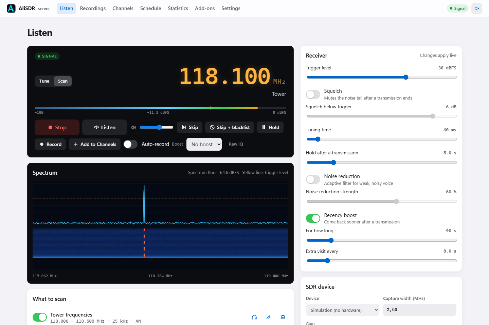

# AliSDR

Current source version: **1.2.3** (unreleased)

On the Channels page, use **Export** to download an XML backup of the complete
Memory List and its folders. Use **Import** on another AliSDR install to restore
it. Channels are matched by carrier frequency; changed entries are shown for
review and stay unchanged unless you choose **Replace with imported**.


A wideband radio scanner for SDR receivers that **records only the
transmissions it actually stops on** - no hours of empty noise, no retuning
clicks. Point it at any band (aviation, marine, PMR, ham repeaters, public
services, military UHF…) and get a searchable library of conversations.

It runs in your web browser: on the computer the SDR is plugged into, or as a
headless receiver you listen to from any phone or PC on your network.

> Listening to and recording some radio services is restricted or illegal in
> many countries - see [Legal](#legal).




## Features

**Scanning**
- Wideband: the whole capture bandwidth of your SDR is analysed at once, so
  several simultaneous conversations on different frequencies are caught and
  recorded in parallel, not one after another.
- Any number of bands (start, stop, step, modulation) plus a Memory List of
  named single channels in folders - sortable by any column, like the
  blacklist (click a header, click again to reverse). Ready-made presets for
  common bands.
- Priority weights for bands and channels, and a short "recency boost" that
  revisits a frequency right after it was active, to catch the reply.
- Per-band overrides: trigger level, gain, hold time, squelch, noise
  reduction.
- Blacklist for carriers and interference, one click from the live view.
- AM, NFM, WFM and SSB demodulation; software or hardware gain control.
- Experimental: several receivers at once - the scan plan is split between
  them, so each band is revisited that many times more often. They can be of
  different kinds and widths (say an RTL-SDR at 2.4 MHz next to a HackRF at
  10 MHz); the plan is shared in proportion to their capture widths.
- Optional **antenna range** per dongle (SDR device card): one on a 2 m
  antenna scans only 144-146 MHz, one on a 70 cm antenna only 430-440 MHz.
  Frequencies outside the receivers' coverage are listed under **Listen → Scan**.
- Optional, experimental digital voice: DMR and Yaesu System Fusion (C4FM)
  through [dsd-fme](https://github.com/lwvmobile/dsd-fme), installed from
  Add-ons → Digital voice. Encrypted calls stay muted.

**Add-ons** (Add-ons page; all optional)
- Decoders that listen to what the scanner already receives: **ACARS** and
  **APRS** (built in), plus **VDL2** (dumpvdl2) and **rtl_433** (sensors:
  weather stations, thermometers, tyre pressure, power, door and alarm
  sensors, tank levels...) as separate programs that take a
  receiver when started separately. With dumpvdl2 installed, Listen can also decode
  configured VDL2 channels during a normal scan. A successfully decoded VDL2
  transmission appears in Messages and its automatic audio recording is discarded.
  Enable **Monitor when receiver is idle** for ACARS, VDL2, or both under Add-ons.
  On one receiver, channels inside its capture width are monitored together and
  wider groups are visited in turn. Tune and Scan take priority. VDL2 supports
  RTL-SDR and Airspy R2 (native libairspy or SoapySDR). Everything decoded appears on the **Messages** page, with
  search, filters, a map link and per-add-on statistics.
- **Notifications** with rules ("a sensor below 0 °C", "a word in an ACARS
  message", "activity on a frequency", "a receiver lost") to ntfy, Telegram,
  Discord/Slack and other webhooks or MQTT. Nothing is sent until you add a
  channel. See `docs/addons.md`.
- A **schedule** per receiver: scan some bands in some hours, run an add-on in
  others.

**Listening**
- Live audio in the browser, with a frequency display, signal level and a
  live spectrum. Voice is levelled (AM by its carrier, then to a steady
  loudness) so a weak airband station and a strong fire channel sound alike;
  Listen has a boost setting, and the Recordings player evens out files too.
- Recordings from known channels use the channel name in the filename.
  **Settings → Recording → Rename existing recordings** applies names to the
  existing library and shows progress. Frequency stays in embedded metadata;
  transcripts, favourites and quality results are retained.
- Multi-recording ZIP downloads group files as `YYYYMMDD/channel name`,
  with frequency folders (for example `20261119/131.000 MHz`) for unnamed channels.
- Skip, skip + blacklist, solo a single band, listen to a single frequency.
- Works on phones, with play/pause/next controls on the lock screen and
  headset.

**Recording**
- One file per transmission (WAV or MP3), named by time and
  frequency, with a configurable hold time to keep call and reply together.
- Squelch, spectral noise reduction, a cap on simultaneous recordings.
- Manual continuous recording and raw IQ capture (SigMF) when you need them.
- Automatic cleanup by age or disk space, keeping favorites.

**Recordings library**
- Browse by frequency, band or language; search by frequency, channel name,
  date or transcript text; filter by time and quality.
- Every recording gets a quality score (signal-to-noise), a waveform and
  click-to-seek playback with auto-advance.
- Favorites, bulk favorite/delete/transcribe, download a whole selection as
  one ZIP, keyboard shortcuts.
- Flight replay for aviation recordings (118-138 MHz and military UHF
  225-400 MHz): one click opens FlightRadar24 or ADS-B Exchange replaying
  the traffic around you at the moment of the recording - to see who was
  talking. Set your approximate location once in Settings → Location.
- Statistics: busiest frequencies, activity by hour, weekday and day.
- Optional speech-to-text with [Whisper](https://github.com/SYSTRAN/faster-whisper)
  (installed from the app; one model, `large-v3`, for every language - an
  English aviation model can be added in the settings, and fixing the language
  skips its detection). It can run on a
  different, faster computer than the one scanning; see
  [what it needs](#transcription-needs-more-than-scanning).

**Server and multiple computers**
- Headless receiver for a mini PC, home server, or container.
- Other computers connect to it to transcribe recordings with their GPU
  and/or keep a verified local copy of the library.
- An RTL-SDR on another computer works as a source too, through its `rtl_tcp`
  server ([network receiver](#network-receiver-rtl_tcp)).
- Optional access password; English and Polish interface (more languages are
  one translation file away).

## Hardware

| Receiver | How |
|---|---|
| RTL-SDR (incl. RTL-SDR Blog V3/V4) | built in on Linux, Windows and macOS |
| HackRF, Airspy | native libhackrf/libairspy support (experimental), or SoapySDR |
| An RTL-SDR on another computer | over the network through its `rtl_tcp` server (since 1.5.0, see [Network receiver](#network-receiver-rtl_tcp)) |
| SDRplay, LimeSDR, USRP, … | through SoapySDR, Linux source install (not tested) |

An RTL-SDR is opened through librtlsdr; on Linux from source also through
SoapySDR - choose under *SDR device → Access method*. HackRF and Airspy work
through the system `libhackrf` / `libairspy` libraries or
[SoapySDR](https://github.com/pothosware/SoapySDR) with the matching module.

HackRF captures 2-20 MHz (the default 2.4 MHz is the safest start); an Airspy
only the fixed widths its board has (for instance 2.5 and 10 MHz on an Airspy
R2), and AliSDR picks the nearest. A wider capture needs more processor -
on a 4-core mini PC about 1, 8 and 19 ms of every 30 ms block go to the
spectrum at 2.4, 10 and 20 MHz, plus 2, 9 and 17 ms for each transmission being
recorded.

Developed and tested with an **RTL-SDR Blog V4** on Linux and Windows 11.
A **HackRF One** has been checked on Linux (10 MHz capture; SoapySDR and
libhackrf both scan, libhackrf reported no lost samples) by
[phutch](https://github.com/phutch) in
[upstream issue #9](https://github.com/rafafunt/FalconSDR/issues/9) - thank you.

**Testing a receiver:** stop the scanner and run `python3 main.py --probe-sdr`
(add `hackrf_native` / `hackrf` /
`airspy_native` / `airspy` to pick the way it is opened, or `rtl_tcp` to
measure the server whose address is saved under **Listen → Scan**). It measures the
gain steps, the DC spike, how many blocks after a retune still hold the old
frequency, and sample losses, and prints one `RESULT {...}`
line - please paste it into an issue together with your receiver's model.

Any antenna works; one cut or tuned for the band you scan works much better.

### Transcription needs more than scanning

Scanning and recording are light - a small mini PC runs them fine. The
figures below are only for the optional speech-to-text (it can also run on
another computer, see [Headless receiver](packaging/remote-server/README.md#headless-transcription-worker)). Pick the
model on the Add-ons page (Transcription).

| Model | RAM (GPU: VRAM) | Word errors, clean / noisy radio |
|---|---|---|
| `small` - smallest usable | 1.4 GB (0.8 GB) | 30 % / 51 % |
| `medium` - best without a GPU | 3.2 GB (1.4 GB) | 23 % / 44 % |
| `large-v3` - default | 3.9 GB (3.3 GB) | 21 % / 38 % |

How long transcribing takes, as a multiple of the recording's length, for
short ~6 s recordings (at 2× it keeps up as long as you record less than
about 30 minutes of audio per hour):

| Model | Mini PC, 4 threads* | Desktop, 8 threads† | Desktop, 24 threads† | Nvidia GPU‡ |
|---|---|---|---|---|
| `small` | 1.0× | 0.5× | 0.3× | 0.03× |
| `medium` | 2.9× | 1.1× | 0.7× | 0.06× |
| `large-v3` | 6.0× | 2.1× | 1.2× | 0.08× |

- A CPU alone is enough to transcribe while scanning: it only has to keep up
  with how much you record, and a queue that builds up in a busy spell empties
  afterwards. An Nvidia GPU makes it 5-20 times faster, which pays off for
  transcribing hundreds of existing recordings quickly or a very busy band.
  AMD/Intel GPUs are not used.
- Scanning plus transcription: at least 4 CPU threads; transcription uses
  the ones beyond 4 (1, 4 and 20 in the columns above; at least one), so 8 is
  comfortable.
- `tiny` and `base` are not usable (45-90 % errors). On a CPU `turbo` is no
  faster than `large-v3`.

\*ThinkCentre mini PC, 4-core i5-6500T, 1 transcription thread. †Ryzen 9
3900X limited to 4 and 20 transcription threads; a slower CPU will be slower.
‡RTX 2070 SUPER. Without language detection (adds ~80 %). Short recordings
are the slower case per second of audio: nine longer ones (13 s to 7 min)
ran up to 2× faster (the mini PC: `small` 0.44×, `medium` 1.0×), but needed
more memory (`medium` peaked at 3.2 GB on the 7-minute one). Rough figures,
one run each.

## Installation

### Headless Linux server

On Debian, Ubuntu, or Raspberry Pi OS, run this on the receiver to build and
install AliSDR with DAB/DAB+ from source:

```sh
curl -fsSL https://raw.githubusercontent.com/PW00X/AliSDR/master/packaging/install.sh | bash
```

Open `http://<receiver-ip>:2424` in your browser. The service starts at boot
and opens **Listen** in **Tune** when idle or **Scan** when scanning. Select
**Scan** in the tuner to start scanning. Run the same command
again to update while keeping your settings and recordings. The service is
`alisdr-server.service`. See the [headless receiver guide](packaging/remote-server/README.md)
for details.

### From a checkout

Install Python 3, Git and the driver for your SDR. From a checkout, create an
environment, install the dependencies, and start the app:

```sh
git clone https://github.com/PW00X/AliSDR.git
cd AliSDR
python3 -m venv --system-site-packages .venv
.venv/bin/python -m pip install -r requirements.txt
.venv/bin/python main.py
```

Open `http://<receiver-ip>:2424` from another device on the network. To build
the DAB decoder from the checkout on Debian-based Linux, run
`sudo sh packaging/dab/install.sh "$PWD/.venv/lib"`.

### Network receiver (rtl_tcp)

An RTL-SDR plugged into another computer (a Raspberry Pi at the antenna, a
box in the attic, a phone running an `rtl_tcp` app) can be the receiver of
the scanner: on that computer run `rtl_tcp -a 0.0.0.0` (package `rtl-sdr`),
then under **Listen → Scan** choose *SDR device → Network receiver (rtl_tcp)* and
type its address (`192.168.1.20` or `192.168.1.20:1234`). Scanning, recording,
transcription and the web interface stay on the computer running AliSDR.

Good to know:
- `rtl_tcp` serves **one program at a time** and the stream is **not
  encrypted** - use it on a trusted network only.
- 2.4 MHz of capture is about 38 Mbit/s: wired Ethernet is fine, Wi-Fi can be
  marginal (pick a smaller capture width if blocks are lost).
- A retune is sent over the network and takes longer than with a dongle on
  USB: on a wired LAN with an RTL-SDR Blog V4 the first clean block came
  after ~180 ms instead of ~100 ms, and a full cycle of 9 capture windows
  took 2.5 s instead of 1.8 s. Scanning many windows is slower; one frequency
  or a few windows are not affected.
- If `rtl_tcp` stops, AliSDR shows *Reconnecting* and resumes by itself
  once the server is back (run `rtl_tcp` as a service that restarts).
- It does not make a weak USB host stronger: the server still reads the
  dongle over its own USB.
- Bias-T is only switched on when you turn it on here (and off again when the
  scanner stops cleanly - if the connection is lost it stays as it was until
  the next session); the server's own setting is otherwise left alone.

## First steps

1. Open **Listen → Scan**, pick your SDR, add a band (or a preset), and press
   **Start**.
2. Raise or lower the **trigger level** until real transmissions open and
   noise doesn't.
3. Switch on **recording** when you're happy with what it stops on.
4. Use **Add to Channels** from **Scan** or a recording to save its frequency
   and other channel settings.

### Tuning FM and DAB/DAB+

Open **Listen → Tune**. For a headless receiver,
run the [headless installer](#headless-linux-server) on the receiver host. It
restarts the service and verifies that the installed revision is serving the UI.

Tune opens with DAB/DAB+ selected on a new browser and remembers the
last modulation you chose. For analog tuning, select a receiver and enter
a frequency in MHz. Use WFM for broadcast FM,
or choose AM, NFM, SSB, USB or LSB for other signals. Press **Tune**, then
**Listen**. Click the spectrum to fill in a nearby frequency. Analog
tuning plays continuously, even below the scanner's trigger level. WFM
streams 48 kHz audio and blends towards mono when the stereo pilot is weak.
Station information shows the RDS service name, programme ID and RadioText
when decoded. Use the star to save the tuned FM frequency. With FM selected in **Tune**, press
**Scan FM stations** to scan 87.5–108 MHz silently and fill the station list.
By default, the list shows stations whose RDS name was decoded. Use
**Show stations without RDS names** to see the other frequencies found by the scan.

Tune and Scan share the saved receiver gain and default to **Auto (hardware)**.
Find **Gain** in **SDR device**, between **Capture width** and **Bias-T**.
Press **Tune** to apply a gain change to the tuned station. Scan applies
gain changes as it runs and shows the measured spectrum floor in dBFS.
A band's own gain settings still apply during Scan.
With the native Airspy driver, the slider shows the 0–21 sensitivity index.

The Linux installer builds DAB/DAB+ by default. AliSDR's Python receiver feeds IQ from the
selected SDR to the [dab-cmdline](https://github.com/JvanKatwijk/dab-cmdline)
shared library and sends decoded audio through AliSDR's live audio stream.

In **Tune**, choose **DAB/DAB+**, pick a Band III channel, and press
**Tune**. Press a station in the list to play it, or use its star to
add or remove it. **Favourites** is selected first in the DAB channel menu each
time Tune opens. Playing a saved station first tunes its channel and
looks for the station in the newly discovered ensemble. Drag the handle next to a favourite to change its order. The browser
stores FM and DAB favourites in a cookie so each profile has its own list. The central station information displays the
ensemble, codec, broadcast text and DAB slideshow artwork when available.

The SDR must capture the Band III ensemble with about 2 MHz of bandwidth.
If reception fails, the receiver reports whether it synchronized or found
audio stations. The browser receives stereo audio at 48 kHz. The spectrum,
waterfall and signal meter are available during DAB reception. On a headless receiver, a timeout
also logs the capture rate, gain and any reported IQ loss to
`journalctl -u alisdr-server`.

Use **Record** once tuned to save the audio to **Recordings**. For DAB,
select a station first. FM and DAB capture stereo audio. **Stop recording**
saves the file while you keep listening. Saved recordings include the station
name when decoded. Switching broadcast stations, stopping tuning or starting
Scan finishes an active broadcast recording.

Pressing **Tune** stops scanning across all receivers. **Start** in Scan mode
ends manual tuning before scanning. **Stop tuning** leaves the receiver idle.

## Tips for good recordings

- **Trigger level** decides what counts as a transmission. Lower = weaker
  stations get recorded, but more noise too.
- **Some frequencies are just a constant carrier or interference** (birdies
  from your own computer or USB hub, a nearby transmitter's harmonics, a dead
  carrier). They trip the trigger all the time and keep you from lowering it.
  Add them to the **blacklist** (Scan → *Skip + blacklist*, or Channels →
  Blacklist). After that you can usually lower the trigger level by several
  dB and pick up the weak stations you were missing.
- **Gain** defaults to *Auto (hardware)*. If a strong nearby station causes
  overload and false detections on neighbouring channels, try *Auto (software)*.
- **Hold after a transmission** (5 s by default) keeps a recording open
  through the pause between a call and its answer.
- A narrower **step** in a band means more channels to check per sweep; use
  the channel spacing the band really uses.
- If the Activity feed says *this computer can't keep up with the SDR*, data
  is being lost (short gaps in audio and recordings): lower the capture
  bandwidth (a wide HackRF capture costs much more than an RTL-SDR's 2.4 MHz),
  or move off a virtual machine - USB passed through to a VM is a common cause.

## Command line

Run from the source checkout.

```
python3 main.py               serve the web app on the network at port 2424
python3 main.py --start       start scanning right away
python3 main.py --host 10.0.0.5 --port 9000   bind a specific interface and port
python3 main.py --version     show the version
python3 main.py --self-test   check this install has everything it needs
python3 main.py --probe-sdr   measure the receiver with the scanner stopped (see Hardware)
```

## Where things are stored

| What | Where |
|---|---|
| Settings, channels, blacklist | `~/.config/AliSDR/` |
| Recordings (default, changeable) | `~/AliSDR/recordings/`, one folder per day |
| Quality scores, transcripts, favorites | `~/.local/share/AliSDR/` |
| Add-ons: decoded messages, statistics, installed programs | `~/.config/AliSDR/addons/` |

(`~` is your home folder, also on Windows.)

## Troubleshooting

- **"Failed to connect… retrying"** - the SDR is missing, in use by another
  program, lacks USB permissions (Linux: udev rule, replug) or has the wrong
  driver (Windows: Zadig).
- **A HackRF or Airspy is plugged in but not listed** - on Linux the Listen
  page names what is missing: SoapySDR (source install; see above) or the
  `libhackrf` / `libairspy` library (`sudo apt install libhackrf0 libairspy0`, Fedora:
  `sudo dnf install hackrf airspyone_host`, or the installer's `--with-sdr-libs`). If one way to open a receiver
  fails, try the other under *SDR device → Access method*.
- **Scanning freezes or the receiver keeps disconnecting** (reported with an
  RTL-SDR v3 on Windows) - switch *Settings → Advanced → Continuous RTL-SDR
  reading* off and start the scan again. It is read as a continuous stream
  while the scanner stays on a frequency; with it off the buzz that 1.3.0
  fixed may come back. Please tell us in an issue whether it helped.
- **Nothing gets recorded** - recording is off, the trigger level is too high,
  or the band's modulation is wrong (aviation is AM, most other VHF/UHF voice
  is NFM).
- **Constant recordings of noise** - blacklist the offending frequencies (see
  above) or raise the trigger level.
- **Distorted audio on strong stations** - switch gain to *Auto (software)* or
  lower the manual gain.

## Feedback and contributing

- **Questions, ideas, your setup:** [Discussions](../../discussions)
- **Bugs:** [Issues](../../issues) - please include the version (Settings →
  Advanced, at the bottom), your OS, how you installed it, your SDR and the
  band.
- **Translations:** the interface is English with a Polish translation in
  `alisdr/locale/pl.po`; a new language is a copy of that file (see
  `alisdr/i18n.py`).
- **Code:** pull requests are welcome; `AGENTS.md` describes the architecture
  and the pitfalls already hit once. Tests: `python -m unittest tests/test_core.py`.

## Legal

The laws on radio monitoring differ a lot between countries. In some places
you may listen to most bands but not record or share what you hear; in
others even listening to non-public services (aviation, police, emergency
services, military) is forbidden. Check what applies where you live before
you scan, and especially before you record or publish anything - you alone
are responsible for how you use this program.

## License

GPL-3.0-or-later (see [LICENSE](LICENSE)) - required by `pyrtlsdr` and the
native librtlsdr dependency. Mutagen uses GPL-2.0-or-later. The optional native receiver libraries carry their own licenses.
Transcription software and Whisper models are not bundled: they are
downloaded on the user's own request from their publishers (faster-whisper,
CTranslate2 and the default model `Systran/faster-whisper-large-v3` are MIT-licensed, as
is the optional English aviation model `jacktol/whisper-medium.en-fine-tuned-for-ATC-faster-whisper`).
Neither is the digital voice decoder: on request, the app downloads
[dsd-fme](https://github.com/lwvmobile/dsd-fme) and
[mbelib](https://github.com/lwvmobile/mbelib) from their authors (the
authors' Windows build; source compiled on the user's machine elsewhere) and
runs dsd-fme as a separate program. The same goes for the add-on programs
(rtl_433, GPL-2.0; dumpvdl2, GPL-3.0, with libacars, MIT): installed on request
from their authors, run as separate programs, never bundled.
